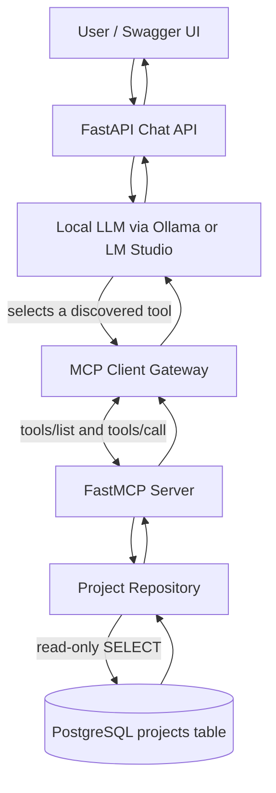
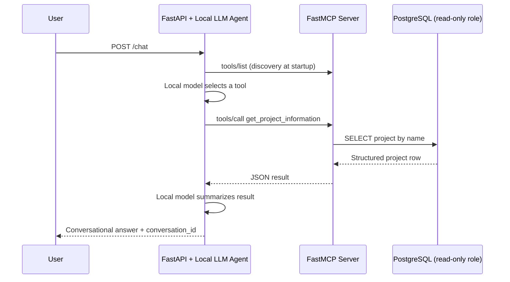

# Project Orion — Conversational Agent + FastMCP POC

A laptop-local proof of concept showing a conversational agent discover and invoke a FastMCP tool to read project data from PostgreSQL. The agent never connects to PostgreSQL directly.

## Architecture



### Sequence



## Quick start (Docker + Ollama on your laptop)

1. Install Docker Compose and [Ollama](https://ollama.com/).
2. Pull a tool-capable local model: `ollama pull qwen2.5:3b`.
3. Copy `.env.example` to `.env`.
4. Start the services: `docker compose up --build`.
5. Open `http://localhost:8080/docs` and call `POST /chat` with `{"message":"Tell me about Project Orion"}`.

Example request from a terminal:

```bash
curl -s http://localhost:8080/chat \
  -H "Content-Type: application/json" \
  -d '{"message":"Tell me about Project Orion"}'
```

The response includes an answer, a `conversation_id`, and `tools_invoked` to make the MCP flow observable. Pass the returned `conversation_id` on the next request to preserve conversational context, for example `{"message":"Who owns it?","conversation_id":"<id-from-previous-response>"}`. Check `/ready` to confirm the API discovered its MCP tool.

The API container connects to Ollama at `http://host.docker.internal:11434/v1` by default. The LLM request uses the local OpenAI-compatible endpoint; no hosted LLM is needed. To use LM Studio, start its local server and edit `LLM_BASE_URL` and `LLM_MODEL` in `.env`. Compose demo credentials are intentionally fixed for convenience; replace them and the reader-role password in `database/init/001_roles.sql` before sharing the environment. If you've already initialized the PostgreSQL volume, changing the init SQL won't re-create the role; reset the demo volume with `docker compose down -v` only if you are okay deleting its data.

## Local development

Use Python 3.12. Install `requirements.txt`, start PostgreSQL, execute `database/init/001_roles.sql` as the database administrator to create the reader role, set `DATABASE_ADMIN_URL` and `DATABASE_URL`, then run `alembic upgrade head`, `python -m database.seed`, and `python -m mcp_server.server`. In another terminal run `uvicorn api.main:app --reload --port 8080`. Ollama or LM Studio should already be running locally with the configured model downloaded.

## Tests

`pytest` runs unit tests without requiring a running database or LLM. For an integration test against the running MCP service, set `RUN_INTEGRATION_TESTS=1` and `MCP_SERVER_URL=http://localhost:8000/mcp`, then run `pytest tests/test_integration.py`.

## Security boundaries

The MCP server uses a dedicated PostgreSQL role with `SELECT` access only and `default_transaction_read_only=on`. The API/agent has no database connection for application queries. Credentials in `.env.example` and Compose defaults are development-only; replace them for any shared environment. The model, database, API, and MCP server run locally. The only first-run network transfer required for the model is pulling the model weights to Ollama/LM Studio.
