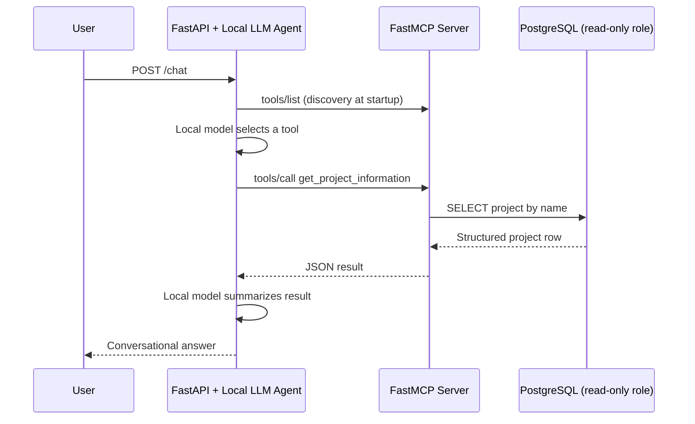

# Project Orion — Conversational Agent + FastMCP POC

A laptop-local proof of concept showing a conversational agent discover and invoke a FastMCP tool to read project data from PostgreSQL. The agent never connects to PostgreSQL directly.

## Architecture

## Quick start (Docker + Ollama on your laptop)

1. Install Docker Compose and [Ollama](https://ollama.com/).
2. Pull a tool-capable local model: `ollama pull qwen2.5:3b`.
3. Copy `.env.example` to `.env`.
4. Start the services: `docker compose up --build`.
5. Open `http://localhost:8080/docs` and call `POST /chat` with `{"message":"Tell me about Project Orion"}`.

The API container connects to Ollama at `http://host.docker.internal:11434/v1` by default. The LLM request uses the local OpenAI-compatible endpoint; no hosted LLM is needed. To use LM Studio, start its local server and set `LLM_BASE_URL` and `LLM_MODEL` in `.env`.

## Local development

Use Python 3.12. Install `requirements.txt`, start PostgreSQL, create the `orion_reader` role (see `database/init/001_roles.sql`), set `DATABASE_ADMIN_URL` and `DATABASE_URL`, then run `alembic upgrade head`, `python -m database.seed`, and `python -m mcp_server.server`. In another terminal run `uvicorn api.main:app --reload --port 8080`.

See `.env.example` for all settings and the tests section below for integration testing.

## Tests

`pytest` runs unit tests without requiring a running database or LLM. For an integration test against the running MCP service, set `RUN_INTEGRATION_TESTS=1` and `MCP_SERVER_URL=http://localhost:8000/mcp`, then run `pytest tests/test_integration.py`.

## Security boundaries

The MCP server uses a dedicated PostgreSQL role with `SELECT` access only and `default_transaction_read_only=on`. The API/agent has no database connection for application queries. Credentials in `.env.example` and Compose defaults are development-only; replace them for any shared environment. The model, database, API, and MCP server run locally. The only first-run network transfer required for the model is pulling the model weights to Ollama/LM Studio.
